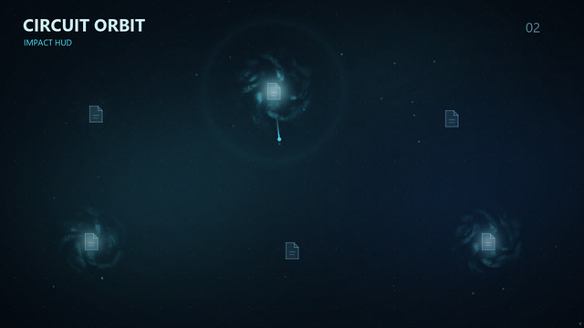
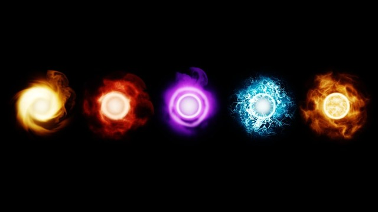

# Lively Wallpaper · Coleção de temas

Quatro papéis de parede animados para o Lively Wallpaper no Windows. Cada tema pode ser instalado e personalizado separadamente.

| Prévia | Tema | O que faz |
| --- | --- | --- |
|  | [Circuit Orbit](circuit-orbit/README.md) | Feixes entre os ícones do desktop, sete marcadores e efeitos de energia que reagem ao mouse. |
|  | [Koi Pond](koi-pond/README.md) | Cinco variedades de carpa 3D reagem ao cursor e disputam petiscos. |
|  | [Lantern Sky](lantern-sky2/README.md) | Lanternas de papel e um céu que acompanha a Lua, o Sol e o clima local. |
|  | [Ori · Spirit Energy Spheres](ori-energy-spheres/README.md) | Cinco esferas procedurais com vórtices, coroas e plasma. |

## Instalar

1. Instale o [Lively Wallpaper](https://www.rocksdanister.com/lively/) e abra-o ao menos uma vez para criar a biblioteca.
2. Clone ou extraia o projeto inteiro e execute `Instalar-temas.cmd` com a sua conta do Windows.
3. Confira o caminho exibido. O instalador procura a biblioteca da Microsoft Store e a da versão desktop, incluindo o caminho personalizado gravado nas configurações. Se precisar informar um caminho, consulte o diretório dos papéis de parede em **Configurações → Geral** no Lively e informe a pasta de dados, `Library` ou `wallpapers`.
4. Escolha os números dos temas separados por vírgula, como `1,3`, ou digite `T` para instalar todos. Se um tema já existir, o instalador pergunta se você quer atualizá-lo com backup.
5. Para recarregar a biblioteca, clique com o botão direito no ícone do Lively perto do relógio e escolha **Sair**. Abra **Lively Wallpaper** pelo menu Iniciar e selecione o tema. Se a cópia falhar porque um tema está em uso, saia do Lively e rode o instalador novamente.

### Pelo PowerShell

Na raiz do projeto, use Windows PowerShell 5.1 ou PowerShell 7.

~~~powershell
.\Instalar-temas.ps1
.\Instalar-temas.ps1 -Biblioteca 'D:\Lively\Library' -Temas koi-pond,lantern-sky2
.\Instalar-temas.ps1 -Biblioteca 'D:\Lively\Library' -Temas todos -Atualizar
~~~

Com `-Biblioteca` e `-Temas`, a instalação roda sem perguntas. Use `-Atualizar` para substituir um tema existente. A pasta anterior é guardada em `Library\BackupsTemas` e o instalador exibe o caminho do backup.

Para recuperar um backup, saia do Lively, mova a versão atual para fora de `wallpapers` e coloque o backup nessa pasta com o nome original do tema. Reabra o aplicativo.

As preferências que o Lively grava em `Library\SaveData` permanecem na biblioteca. Se novos controles de um tema atualizado estiverem ausentes, a opção de restaurar os padrões em **Personalizar** redefine as preferências desse tema e carrega os controles atuais.

## Prévia e personalização

Abra o `preview.html` do tema no navegador. No Lively, use **Personalizar** no menu do tema. Temas que reagem ao cursor precisam da entrada de mouse habilitada nas configurações do Lively. Koi Pond usa WebGL e Ori exige WebGL2 com suporte a renderização em buffers de ponto flutuante.

Para usar o Circuit Orbit com os seus ícones, siga a documentação de coleta do tema. O Lantern Sky usa serviços meteorológicos para acompanhar o clima e também tem cenários de demonstração offline.

## Manutenção

- `catalogo.json` registra os temas, seus destinos e os arquivos que serão copiados.
- Cada tema inclui `index.html`, `LivelyInfo.json`, `LivelyProperties.json`, miniatura e documentação. Os caminhos em `LivelyInfo.json` são relativos à pasta do tema.
- Para adicionar um tema, registre sua pasta e seus arquivos no catálogo e teste a instalação em uma biblioteca descartável com uma subpasta `wallpapers`.
- O histórico do Circuit Orbit anterior à coleção está nos branches locais `archive/circuit-orbit/*` e nas tags `circuit-orbit/*`.

## Autoria e licenças

Os créditos de cada tema constam no respectivo `LivelyInfo.json`. As licenças de dependências acompanham os temas que as utilizam. O Lantern Sky original é de Dre e foi incluído com as adaptações de clima, astronomia e paisagem. As condições de redistribuição devem ser verificadas por tema antes de publicar a coleção.
