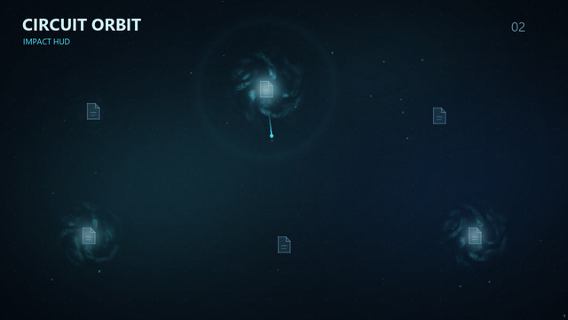

# Circuit Orbit · Impact HUD



Versão `2.5.0-beta.2`. Um feixe de energia percorre os ícones do desktop e ativa marcadores a cada impacto. A versão original e as revisões anteriores estão nas tags `circuit-orbit/*` do repositório.

## Todos os marcadores aleatórios

**Aleatório — todos os marcadores** mistura os sete estilos. Cada estação usa um dos sete com a mesma probabilidade, determinado pela amostra aleatória de orientação já criada no primeiro impacto. O estilo fica estável durante toda a vida do marcador, inclusive ao ser atingido novamente antes de desaparecer. Depois de expirar, o próximo impacto pode escolher outro. O sorteio não consome novos números do gerador que escolhe os destinos e não altera o percurso dos tiros.

O modo misto compartilha um único contexto WebGL e os programas dos shaders. Mantém até cinco simulações de 256×256, uma por arquétipo v7 presente; todas as estações do mesmo tipo reutilizam sua imagem. Tipos que deixam a tela liberam os buffers. Voltar a um estilo fixo mantém apenas a simulação necessária. Por animar vários tipos ao mesmo tempo, o modo misto pode custar mais GPU que selecionar um único marcador; o consumo real ainda não foi medido. As cores, o brilho e a permanência existentes continuam valendo.

## Cinco marcadores dos estudos v7

O seletor **Marcador** oferece também **Vórtice Solar**, **Combustão Radial**, **Pulso de Éter**, **Tempestade de Plasma** e **Estrela Solar**. São os cinco arquétipos dos arquivos `ori-energy-spheres/app.js` e `shaders.js` fornecidos pelo usuário; a pasta de estudo fica preservada. A vitrine do estudo é uma composição das cinco esferas, não um sexto marcador.

`ori-orb-shaders.js` preserva os shaders v7 e adapta apenas a saída: fundo transparente, bordas suaves e composição sobre o wallpaper. `ori-orbs.js` adapta o simulador e os emissores para uma imagem compartilhada de 256×256, com grade física de 128×128, 12 iterações de pressão e atualização máxima de 30 Hz. O custo da simulação não cresce com o número de ícones; cada marcador desenha uma cópia da imagem, com orientação e pulsação próprias. Os movimentos internos da esfera e da fumaça são compartilhados. Nenhum serviço ou agendador paralelo é iniciado.

Os marcadores aparecem somente no impacto, contraem e intensificam na carga, expandem no disparo e usam a mesma permanência percentual. **Cores originais dos orbes** mantém as paletas dos estudos; desmarque para usar **Cor dos efeitos**. Brilho e tamanho continuam nos controles existentes. Trocar de estilo preserva o percurso e as estações atingidas. Display futurista e Núcleo de névoa mantêm os valores antigos (0 e 1), e a escolha salva é preservada na atualização.

Sem WebGL2/float, os cinco estilos usam o núcleo procedural anterior como alternativa. A miniatura existente representa esse núcleo, ainda disponível no seletor. Não há captura automática de ícones nem recursos gráficos extraídos dos jogos.

## Explosão de energia ao clicar

Cada clique esquerdo no wallpaper injeta um pulso central e oito impulsos para fora, criando uma explosão de névoa turbulenta no cursor. **Explosão de energia ao clicar** ativa ou desliga essa reação, habilitada por padrão. Usa a cor dos efeitos e a intensidade de **Brilho**. Funciona também com o efeito do mouse desligado, o tiro Laser selecionado ou nenhum ícone no monitor.

O efeito compartilha a camada de energia dos tiros; não cria outro contexto WebGL nem um laço permanente. Sem novas emissões, a energia se dissipa em cerca de 1,6 segundo. Cliques repetidos usam as filas limitadas existentes. Cliques nos controles da prévia e botões diferentes do esquerdo são ignorados. O listener não bloqueia a seleção ou abertura de ícones; depende dos eventos de mouse encaminhados pelo Lively.

## Tiro alternativo: energia fluida

**Efeito do tiro** permite escolher **Laser** ou **Energia fluida**, selecionado por padrão nesta revisão. O segundo usa o mesmo simulador WebGL do mouse, em uma camada independente: o projétil deixa névoa turbulenta e, ao atingir um ícone, injeta uma explosão central com oito impulsos para fora. Funciona com qualquer marcador e com o efeito do mouse desligado. A trajetória e a aceleração são preservadas; a troca de estilo mantém o voo atual.

**Brilho** controla a intensidade; **Rastro do tiro** controla a largura e a duração residual da energia (aproximadamente 0,72 a 2,55 segundos após a última emissão, conforme o valor). Ao selecionar Laser, os resíduos são limpos. O mapa e o tamanho do monitor também limpam resíduos antigos. Em equipamentos sem WebGL2/float, há uma alternativa 2D com até 96 amostras temporárias.

`shot-fluid.js` amostra o trajeto em até 24 pontos por quadro para reduzir falhas em tiros rápidos. A fila de injeções tem limite de 48 e o fluido atualiza a até 30 Hz pelo agendador existente; não há serviço ou laço independente. A segunda camada WebGL é criada somente ao usar Energia fluida. Quando mouse e tiros estão ativos juntos, existem duas simulações; o custo real de CPU/GPU ainda não foi medido. A miniatura de catálogo existente continua representando o orb com o estilo Laser disponível.

## Marcador alternativo: núcleo de névoa

O controle **Marcador** alterna entre **Display futurista** e **Núcleo de névoa**, selecionado por padrão nesta revisão. A troca preserva os ícones já atingidos, a carga atual e a ordem dos tiros. Nenhum marcador aparece antes do impacto.

O núcleo é um orb translúcido luminoso, inspirado na referência visual de Ori fornecida pelo usuário. O centro fica mais claro, quase branco, e produz línguas de energia que se curvam e se dissipam para fora em direções irregulares. O movimento parte do centro; não há furo central ou borda circular rígida. A transparência limita a sobreposição sobre o ícone. Na carga, contrai e intensifica o brilho; o impacto e o disparo expandem a coroa de energia. A cor, o brilho, o tamanho e a permanência existentes também controlam esse estilo. A permanência percentual e o fade de 900 ms são os mesmos do display. Os desenhos são procedurais, sem copiar imagens do jogo para o tema.

`nucleus.js` gera uma sequência cíclica compartilhada de 24 texturas de 192×192, com interpolação entre quadros. A fase radial avança para fora e o ruído deforma os filamentos; o ciclo não tem salto de orientação no fechamento. Cada estação tem uma fase diferente; não existe uma simulação WebGL por ícone nem acúmulo de partículas. São duas imagens por estação/quadro. A sequência é criada ao abrir e recriada ao trocar a cor. O custo real no Lively ainda não foi medido. A névoa do mouse continua usando sua camada WebGL independente.

## Animação

Um primeiro tiro entra pela borda da tela e atinge um ícone. Somente no impacto surgem os arcos, segmentos e marcadores do display. Os anéis giram em sentidos diferentes, o indicador interno carrega e o brilho se concentra antes do disparo seguinte.

O destino é sorteado de uma lista de ícones disponíveis e retirado dela. Todos são visitados uma vez antes de a lista ser preenchida novamente. Na passagem entre rodadas, o próximo destino não pode ser o próprio emissor. O tiro percorre uma reta com aceleração progressiva e termina em um clarão local com partículas curtas. Não há circuito permanente, números sobre os ícones ou displays previamente acesos.

A aceleração dura 80 ms em qualquer distância; depois o tiro segue com velocidade constante, sem frear antes do impacto. Em percursos muito curtos, chega durante a própria rampa. A distância percorrida nos primeiros instantes é igual para destinos próximos ou distantes, até atingir o destino. Alterar a velocidade em voo preserva a posição atual.

A permanência dos displays é uma porcentagem do número de ícones da área escolhida, de 1% a 99%, com padrão de 60%. Com dez ícones e 60%, o primeiro display permanece intacto até o sexto impacto e começa a desaparecer no sétimo. O limite é arredondado para baixo, com mínimo de um ícone: `max(1, floor(total × porcentagem / 100))`. O fade começa no impacto, não durante o voo, e dura 900 ms. Um novo impacto no mesmo ícone reacende seu display.

Com um único ícone, o display recebe o tiro inicial e repete a carga local. Sem ícones no monitor, a névoa e as partículas continuam animando o fundo. Se também estiverem desligadas, o laço de desenho para.

## Ambiente de energia

Três nuvens difusas em ciano e azul se deslocam lentamente ao fundo. Poucas partículas atravessam a tela em profundidades e velocidades diferentes. Cada impacto em um ícone produz uma onda suave que ilumina uma área maior e desaparece em 1,6 segundo. O ambiente usa a cor escolhida nos efeitos e não altera a rampa, a ordem das visitas nem os marcadores.

Os efeitos são independentes: coloque a intensidade ou a quantidade em zero para desligar névoa, partículas ou ondas. Padrões: névoa 45%, 32 partículas e ondas 40%. Não há núcleo central nem filamentos adicionais.

O mouse injeta fumaça em uma simulação de fluido WebGL2, adaptada dos shaders do tema local Fluids, de Pavel Dobryakov (MIT). A velocidade do movimento produz redemoinhos, filamentos e bordas irregulares. A fumaça se deforma e se dissipa em até 2,4 segundos após parar. As partículas próximas continuam reagindo ao cursor. Coordenadas repetidas não mantêm um halo; saltos grandes entre monitores não criam uma trilha atravessando a tela.

A névoa ambiente mantém as texturas procedurais suaves e a granulação discreta para reduzir faixas de luminosidade. A fumaça do mouse usa uma camada própria, com intensidade padrão de 35% e tamanho de 260 px. Sem WebGL2 com buffers de ponto flutuante, há uma alternativa 2D simplificada. Os créditos e a licença estão em licenses/Fluids-MIT.txt.

A entrada usa os [eventos JavaScript normais encaminhados pelo Lively](https://github.com/lively-community/lively/wiki/Web-Guide-IV-%3A-Interaction#mouse--keyboard), em coordenadas locais da janela, sem consultar a posição global do mouse ou iniciar utilitário. Depende da entrada de mouse habilitada no Lively. Mover o cursor sobre os controles da prévia não alimenta o efeito.

## Configurar e abrir

1. Execute `Abrir-previa.cmd` para registrar o coletor local da v2 e abrir a prévia. A tecla **P** abre ou fecha as opções.
2. Clique em **Coletar posições dos ícones**. O Windows pode pedir autorização para abrir o utilitário. Ele executa uma vez, salva o mapa em `settings/` e encerra.
3. Se mover os ícones ou mudar os monitores, colete novamente. O mapa não muda automaticamente.

`Coletar-icones.cmd` executa a mesma coleta diretamente. Ao mover a pasta, execute `Configurar-utilitario.cmd` para atualizar o destino do botão. Não há servidor permanente, serviço, tarefa agendada, consulta de rede ou inicialização automática.

O atalho da v2 é `circuit-orbit-v2://collect`, registrado somente no usuário atual. Ele não interfere no atalho `circuit-orbit://collect` da versão 1. O comando de coleta é fixo e ignora argumentos da URL. `Remover-atalho-do-utilitario.cmd` remove apenas a associação desta versão.

## Opções

| Controle | Função |
| --- | --- |
| Cor dos efeitos | Cor dos tiros e displays |
| Velocidade do tiro | 40 a 800; atua no deslocamento acelerado |
| Brilho | Intensidade dos efeitos |
| Rastro do tiro | Comprimento do feixe atrás do projétil |
| Tamanho do display | 40% a 200%, relativo ao tamanho do ícone |
| Tempo de carga | 300 a 2400 ms antes do próximo disparo |
| Permanência | 1% a 99% do total de ícones; define quando os marcadores antigos começam o fade |
| Quadros por segundo | Limite de 30 ou 60 FPS; movimento baseado no tempo |
| Área | Automático, área estendida ou monitor explícito |
| Névoa de energia | Intensidade de 0% a 100% |
| Partículas de energia | Quantidade de 0 a 70, em camadas |
| Ondas de impacto | Intensidade de 0% a 100% |
| Névoa do mouse | Habilita ou desliga a reação ao cursor |
| Intensidade do mouse | 0% a 100%, padrão 35% |
| Tamanho da nuvem | 60 a 500 px, padrão 260 px |

As alterações da prévia são temporárias; o Lively persiste suas próprias opções. Para simular sem mapa real, abra `index.html?preview&demo`; a tela informa **DEMONSTRAÇÃO**.

## Instalação no Lively

Selecione `circuit-orbit` no [instalador da coleção](../README.md#instalar). O destino é `Library/wallpapers/circuit-orbit-v2`, permitindo manter a versão 1 em `circuit-orbit`. Reinicie o Lively e aplique o tema. Abra `preview.html` para a prévia padrão ou use o endereço da demonstração acima para ver ícones simulados.

O instalador da coleção preserva o mapa de uma instalação v2 existente. Para gerar um mapa neste computador, rode `Coletar-icones.cmd` na pasta instalada ou configure o atalho seguindo as instruções de coleta. O mapa é local e fica em `settings/`.

`tools/Install-Theme.ps1` é o instalador anterior, mantido para o fluxo de desenvolvimento específico do Circuit Orbit.

O leitor usa retângulos físicos, inclusive coordenadas negativas. O tema projeta cada ícone no monitor escolhido. Em escala mista, a seleção automática precisa de conferência no Lively; existe seleção explícita. A numeração do tema começa pelo principal e pode diferir da numeração do Windows. Uma janela de prévia redimensiona o mapa, portanto não permite confirmar o alinhamento físico com os ícones do desktop.

## Implementação e consumo

- `engine.js`: simulação independente do Canvas, sorteio, aceleração, fases e vida dos displays.
- `hud.js`: desenho dos arcos, carga, feixe e impacto.
- `atmosphere.js`: névoa, partículas ambientais e ondas de impacto.
- `app.js`: propriedades do Lively, projeção dos monitores, coleta manual e agendamento de quadros.
- Fundo base e grade são CSS estático. A névoa reutiliza texturas de nuvem de 512×512, em uma camada que acompanha a densidade da tela até 3840×2160 pixels, atualizada no máximo 20 vezes por segundo. A onda usa uma textura de 256×256 e a granulação uma de 64×64. Não há reconstrução de gradientes de tela inteira em cada quadro. A resolução maior pode elevar o custo da camada; não foi medido um ganho de desempenho nesta revisão.
- Não há histórico crescente de trilhas: somente os displays recentes, partículas curtas e um tiro ativo são mantidos.
- O limite de FPS não altera a velocidade da simulação. Há no máximo 70 partículas ambientais e seis ondas simultâneas; as ondas expiram. Um monitor sem ícones e sem ambiente ativo não mantém um laço de desenho.
- mouse-fluid.js: fluido do cursor a até 30 atualizações por segundo, grade de velocidade de 128 pixels no lado curto e densidade de 384, limitadas a 1024 no lado longo. Dez iterações de pressão; sem bloom ou laço separado. A fila tem no máximo doze entradas. Após 2,4 segundos sem movimento, limpa a camada e suspende os cálculos do fluido. O custo real desta simulação na GPU ainda não foi medido.

Essas alterações reduzem trabalho desnecessário identificado na v1. O ganho real de CPU/GPU ainda precisa ser medido. `ANALISE_DE_DESEMPENHO.md` é o relatório histórico da v1, não uma medição desta versão.

## Verificar

A miniatura estática `thumbnail.jpg` e a prévia animada `preview.gif` são usadas pela biblioteca do Lively. A animação de seis segundos usa o motor e a geometria reais do HUD, com posições e ícones genéricos. É apenas uma prévia de catálogo e não altera o fundo do tema.

Para regenerar: execute `node tools/Build-Thumbnail.cjs`, depois `python tools/Render-Thumbnail.py` e converta os frames de `outputs/thumbnail/` para GIF com FFmpeg. As ferramentas de geração não são copiadas para a instalação.

```
node tests/engine.test.cjs
node tests/app.test.cjs
node tests/atmosphere.test.cjs
node tests/mouse-fluid.test.cjs
```

Os testes cobrem impacto antes de acender o HUD, carga, aceleração, destinos sem autorrepetição, desvanecimento, limites de objetos, monitores vazios/únicos, coordenadas negativas, limites de FPS e coleta pontual. A validação no navegador e os limites da validação física estão em `VALIDACAO.md`.
