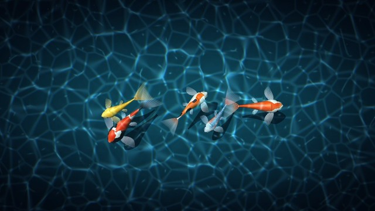

# Koi Pond · 5 Carpas Koi 3D (Lively Wallpaper)

Cinco carpas 3D procedurais nadam num lago em vista superior, com cáusticas animadas na água. O tema funciona offline com WebGL e inclui Three.js 0.170.0 e lil-gui 0.20.0. As licenças estão em [vendor](vendor/).

## Os 5 Modelos de Carpa & Personalidades
1. **Kohaku (Clássica Real)** — Branca perolada com grandes manchas vermelho-alaranjadas. Nado equilibrado, medo moderado e boa curiosidade.
2. **Taisho Sanke (Tricolor)** — Branca perolada, laranja vibrante e detalhes pretos *Sumi*. Ágil, curiosa e competitiva por petiscos.
3. **Showa Sanshoku (Negra & Carmesim)** — Base escura aveludada com faixas brancas e vermelho-fogo. Maior, calma, gosta de deslizar devagar e é a mais corajosa (foge menos longe).
4. **Yamabuki Ogon (Ouro Puro)** — Dourado metálico luminoso com cauda véu longa. Rápida, inquieta e muito arisca (percebe o mouse de longe e dá arrancadas longas).
5. **Asagi Shusui (Azul-Prata & Coral)** — Dorso azul-ardósia prateado reticulado, laterais coral e cauda véu. Tímida ao movimento, mas a mais curiosa quando o mouse fica parado.

## Interações com o Mouse
- **Mover o mouse perto:** cada carpa foge no seu próprio estilo (alcance de medo, velocidade e distância de fuga individuais).
- **Deixar o mouse parado:** após alguns instantes, as carpas ficam curiosas e se aproximam para circular em torno do cursor; se você mexer o mouse de novo, elas se assustam e fogem!
- **Clicar na água:** solta um petisco flutuante com ondulação na superfície que atrai as carpas até que uma delas o alcance e coma.

## Controles e Atalhos
- Abra `preview.html` ou execute `Abrir-previa.cmd` para testar no navegador. Use `P` ou `H` para mostrar ou ocultar os controles e `Espaço` para soltar um petisco.
- Instale `koi-pond` pelo [instalador da coleção](../README.md#instalar). No Lively, abra **Personalizar** para ajustar quantidade, velocidade e tamanho das carpas, cáusticas e interação.

`vendor/three.min.js` foi gerado a partir de `build/three.module.js` do pacote npm Three.js com esbuild 0.25.12 (`--bundle --format=iife --global-name=THREE --minify --target=es2020`). O lil-gui usa a distribuição UMD oficial.
