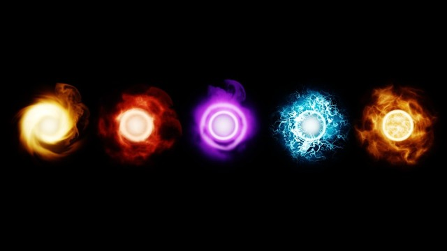

# Energy Spheres

Estudo visual inspirado nas esferas de energia de *Ori and the Blind Forest*. Os efeitos são desenhados proceduralmente em WebGL2, com simulação de fluido e shaders GLSL.

| Tecla | Arquétipo | Efeito |
| --- | --- | --- |
| `1` | Vórtice Solar | Fitas douradas em espiral |
| `2` | Combustão Radial | Erupções carmesim ao redor do núcleo |
| `3` | Pulso de Éter | Ondas violetas concêntricas |
| `4` | Tempestade de Plasma | Filamentos e raios ciano |
| `5` | Estrela Solar | Fotosfera envolta por uma coroa luminosa |
| `6` | Vitrine | Todos os arquétipos lado a lado |

Abra `preview.html` no navegador. Pressione `P` para mostrar ou ocultar os controles. O tema exige WebGL2 com a extensão `EXT_color_buffer_float`.

No Lively, instale `ori-energy-spheres` pelo [instalador da coleção](../README.md#instalar) e abra **Personalizar**. Ajuste o arquétipo, tamanho, emissão, velocidade da simulação, turbulência, duração da fumaça, brilho e resposta ao mouse.

## Créditos

- **Eduardo Mizael Clemente** desenvolveu o estudo procedural. Suas contribuições estão sob a licença MIT incluída no pacote.
- A referência visual é a tela de habilidades de **Ori and the Blind Forest**, desenvolvido pela **Moon Studios** e publicado pela **Microsoft Studios**. [Créditos oficiais do jogo](https://www.xbox.com/en-us/games/store/ori-and-the-blind-forest/C0MCC9R22KBJ)
- O shader reutiliza o **Hash without Sine** (`hash12`), de **David Hoskins**, para gerar ruído procedural. [Publicação original](https://www.shadertoy.com/view/4djSRW) · [Licença MIT](licenses/Hash-without-Sine-MIT.txt)
